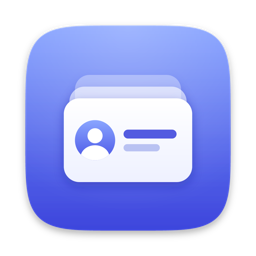
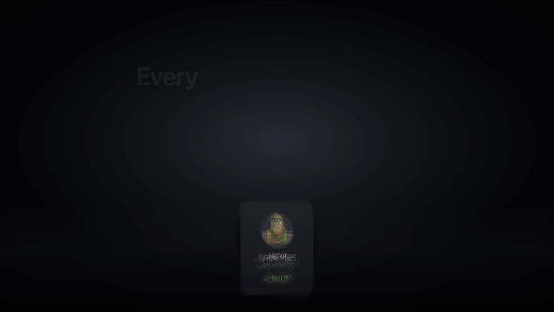
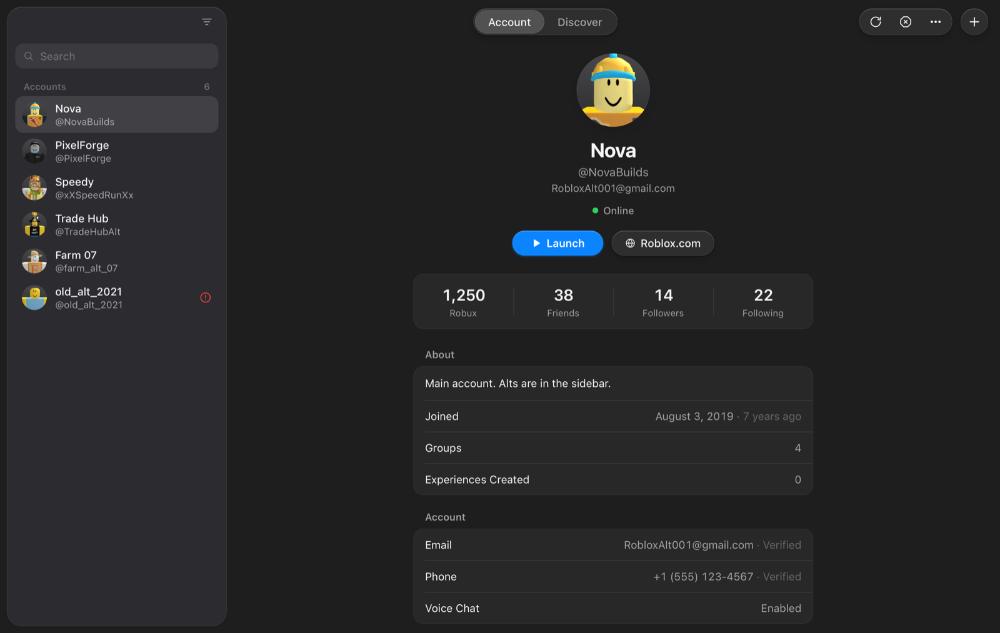
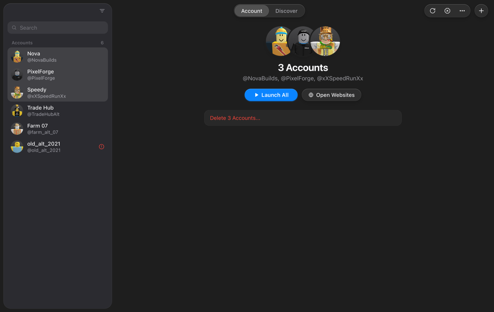
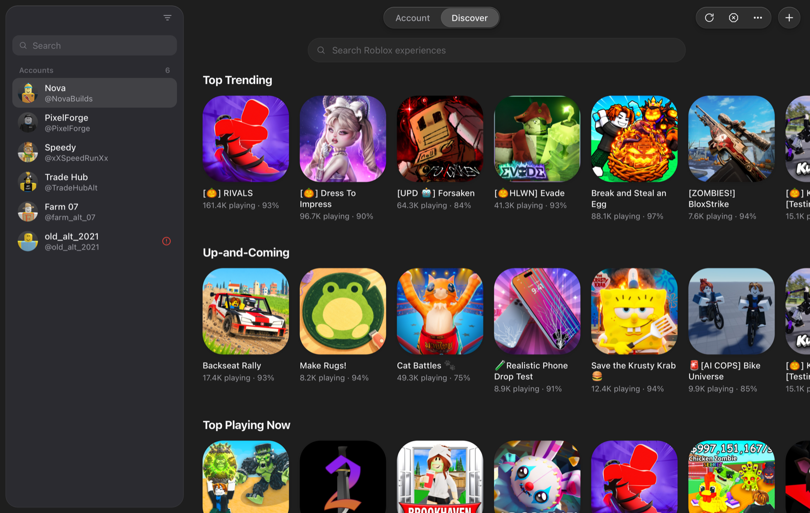
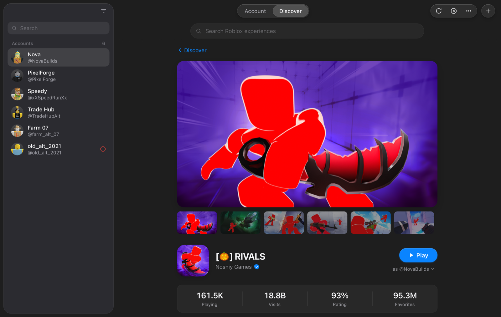
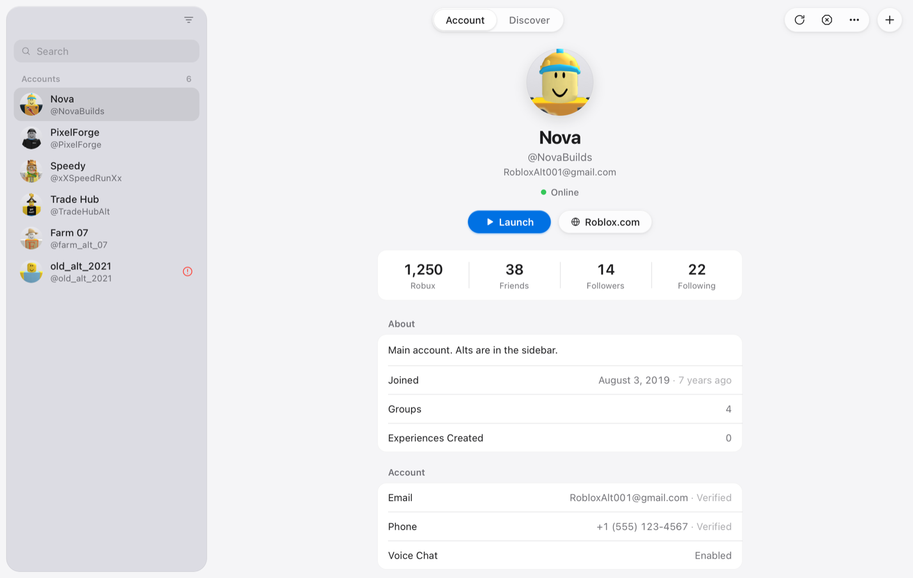

<p align="center">
  
</p>

<h1 align="center">AltDeck</h1>

<p align="center">
  <b>Every account. One deck.</b><br>
  The Roblox account manager for Mac: native, tiny, and built to run your alts side by side.
</p>

<p align="center">
  <a href="https://github.com/JadXV/AltDeck/releases/latest"><b>Download</b></a> ·
  <a href="#installation">Install</a>
</p>

<!-- 

if i ever feel like adding the showcase video thing i can do it here 

-->

<p align="center">
  
</p>

---

## Screenshots

<p align="center">
  
  <br><sub>Every account at a glance: status, Robux, friends, profile details and one-click launch.</sub>
</p>

<table>
  <tr>
    <td width="50%"><br><sub><b>Multi-launch.</b> Select several accounts and launch them all side by side.</sub></td>
    <td width="50%"><br><sub><b>Discover.</b> Browse Roblox's charts or search any experience.</sub></td>
  </tr>
  <tr>
    <td width="50%"><br><sub><b>Game pages.</b> Screenshots, stats and a Play button that launches the selected accounts straight into the game.</sub></td>
    <td width="50%"><br><sub><b>Light and Dark.</b> Follows your Mac's appearance.</sub></td>
  </tr>
</table>

<sub>Screenshots use demo accounts.</sub>

## Design

AltDeck is a Rust app with an HTML interface, but the whole point was to make it look and feel like Apple made it. Not "web app with a Mac theme", but something that could pass for a first-party macOS app.

That meant following Apple's own apps (Passwords, Contacts, System Settings) instead of web conventions:

- A floating translucent sidebar with the traffic lights inside it, like macOS Tahoe
- Real system materials and vibrancy, SF Pro, Apple's system colors, and automatic Light and Dark mode
- Native context menus, sheets and dialogs instead of custom web popups
- Grouped, inset lists like System Settings, and a Contacts-style card for each account
- Glass toolbar buttons, a segmented control for tabs, and proper Mac keyboard shortcuts
- Window controls lined up exactly with the toolbar, measured against the real window

If something looks or behaves like a web page instead of a Mac app, that's a bug.

## Features

**Accounts**
- Add accounts by signing in on Roblox's own login page. The session is captured automatically, no cookie copying
- Every account is re-checked on launch; expired sessions are flagged and can be refreshed with **Sign In Again**
- Account pages show the avatar, live presence (online / in game / in Studio), Robux, friends, followers, following, bio, join date, groups and more
- Search, sort (newest, oldest, A-Z, Z-A), import and export

**Launching**
- Run multiple Roblox instances at the same time, each signed in to a different account
- Select several accounts (⌘-click / ⇧-click) and launch them all at once
- **Quit All Roblox** closes every running instance in one click

**Discover**
- Browse Roblox's home charts: Top Trending, Up-and-Coming, Top Playing Now and more
- Search any experience, open its page for screenshots, player counts, rating and details
- **Play** launches the selected account(s) directly into that game; right-click for *Play As* any account

**Websites**
- Open roblox.com signed in as any account, each in its own window
- On macOS 14+ every account gets an isolated browser session

**A real Mac app**
- Built in Rust with [Tauri](https://tauri.app) on the system WebKit, about **5 MB**, no bundled Chromium
- Floating translucent sidebar, native menus, sheets and dialogs, Light and Dark mode
- Keyboard-first: ⌘N add · ⌘F search · ⌘R re-check · ↩ launch · ⌫ delete · ⌘1 / ⌘2 switch tabs

## Installation

### Quick install (recommended)

```bash
curl -fsSL https://raw.githubusercontent.com/JadXV/AltDeck/refs/heads/main/install.sh | bash
```

### Manual install

1. Download the latest release from [GitHub Releases](https://github.com/JadXV/AltDeck/releases)
2. Extract the ZIP and move the right app to Applications:
   - Apple Silicon: `AltDeck-ARM64.app`
   - Intel: `AltDeck-x86_64.app`
3. Rename it to `AltDeck.app`
4. Run `xattr -rd com.apple.quarantine /Applications/AltDeck.app`
5. Open AltDeck

### Requirements

- macOS 11 (Big Sur) or later. macOS 14 (Sonoma) or later for isolated per-account website sessions
- Roblox installed in `/Applications` or `~/Applications`

### First launch: App Management permission

To run several Roblox instances, AltDeck has to edit Roblox's app bundle, which macOS protects. The first time you launch, allow AltDeck under **System Settings > Privacy & Security > App Management** (AltDeck opens that page for you if it's blocked).

## How it works

**Signing in.** AltDeck writes each account's Roblox session cookie to a per-account cookie store (`~/Library/HTTPStorages/com.roblox.RobloxPlayer.<userId>.binarycookies`), so the player starts already signed in.

**Multiple instances.** Just before launching, AltDeck temporarily changes the Roblox app's bundle identifier to `com.roblox.RobloxPlayer.<userId>` so macOS treats each instance as a separate app, then restores it a few seconds later.

**Storage.** Accounts are saved in `~/Documents/AltDeck/accounts`, encrypted with AES-256-GCM using a key derived from your macOS username. This keeps the file unreadable at a glance, but it is not a substitute for protecting your Mac account. Anyone signed in as you can read it. Exports are plain JSON; AltDeck warns you before writing one.

## Building from source

Requires the [Rust toolchain](https://rustup.rs) and the Tauri CLI (`cargo install tauri-cli --version "^2"`).

```bash
cd src-tauri
cargo tauri dev
cargo tauri build
```

`./build.sh` produces the release zip (`AltDeckCompressed.zip`, ARM64 + x86_64) used by `install.sh`.

**Project layout**

| Path | What's there |
|---|---|
| `ui/index.html` | The interface |
| `src-tauri/src/` | Rust backend: account storage & encryption, Roblox API, launcher, game discovery, login/website windows, updater |
| `assets/icon.svg` | App icon source |
| `docs/` | README images (screenshots, preview GIF, icon) |
| `build.sh` | Builds the release zip used by `install.sh` |
| `install.sh` | One-line installer and updater |

## Updates

AltDeck checks GitHub for a newer release on startup and offers to update. You can also re-run the install command at any time.

## Credits

Developed by JadXV.

## License

See [LICENSE](LICENSE).
